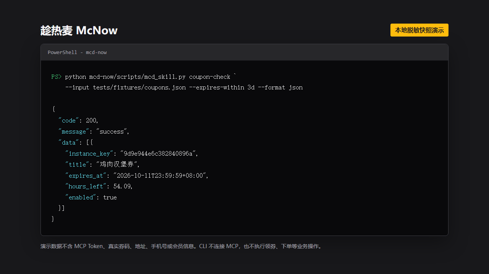

# 趁热麦 McNow

> 券要趁早，麦要趁热。

趁热麦是一个面向麦当劳中国个人用户的 Skill。它记录用户明确表达的点餐偏好，
在交互式会话中检查临期优惠券及附近可核销门店，并生成符合口味和组餐习惯的
到店自取建议。

## 目标用户

- 经常忘记优惠券有效期，希望在过期前得到清晰提醒的个人用户。
- 有稳定口味、忌口或组餐习惯，不想每次重新解释偏好的用户。
- 希望先确认门店可核销、餐品可买和最终价格，再决定是否下单的用户。

## 核心能力

- 管理忌口、偏爱、口味、组餐、预算和履约偏好。
- 发现可领取的优惠券，并按到期时间巡检用户券包。
- 校验优惠券在附近门店的可用性，推荐最近的可核销门店。
- 根据单点、套餐、饮料和特调偏好生成候选组合。
- 使用麦当劳 MCP 核验到店自取价格；所有下单操作均需用户明确确认。
- 用户确认后创建到店自取订单，返回支付入口并查询最新支付或履约状态。
- 提供本地 CLI，支持对用户主动导出的脱敏快照做定时提醒。

## 当前状态

项目处于首版验证阶段。当前已实现本地偏好管理、临期券提醒、附近门店券验证、
个性化菜单推荐、实时核价、订单确认指纹、确认后二次核价与到店自取下单编排。
券包、可领券、附近门店、门店券、菜单、餐品详情和核价已完成只读实测；真实创建
订单仍需用户明确授权后人工验证，不能由测试或计划任务自动执行。

首版只支持个人场景和到店自取。得来速、麦乐送属于后续版本，企业团餐不在项目
范围内。跨门店推荐只在当前门店无法核销目标优惠券时作为补救建议。

## 安装

要求 Python 3.10 或更高版本。首版本地能力只使用 Python 标准库。

```bash
git clone https://github.com/xujay0521/mcd-now.git
cd mcd-now
python mcd-now/scripts/mcd_skill.py doctor
```

在 Codex、WorkBuddy 等支持 MCP 的交互式宿主中，使用
[mcp-config.example.json](mcp-config.example.json) 配置连接。实际 Token 仅放在宿主的
安全配置或环境变量中，不要写入仓库：

```text
MCD_MCP_URL=https://mcp.mcd.cn
MCD_MCP_TOKEN=<your-token>
```

## 使用示例

记录长期偏好：

```bash
python mcd-now/scripts/mcd_skill.py preference add \
  --category favorite --value "鸡肉汉堡"
python mcd-now/scripts/mcd_skill.py preference add \
  --category meal_structure --value "优先单点，不需要饮料"
python mcd-now/scripts/mcd_skill.py preference add \
  --category restriction --value "花生过敏" --confirm-sensitive
python mcd-now/scripts/mcd_skill.py preference update \
  --id pref_xxx --value "优先单点，套餐不要含甜饮"
python mcd-now/scripts/mcd_skill.py preference list
```

`restriction` 可能包含敏感饮食信息。CLI 只有在用户核对内容后传入
`--confirm-sensitive` 才会保存；对话模式必须先复述并取得明确确认。

交互式会话可在用户当次请求中调用麦当劳 MCP 查询实时券包。CLI 不直接连接 MCP；
对用户主动导出并脱敏的快照检查未来 3 天内到期的券：

```bash
python mcd-now/scripts/mcd_skill.py coupon-check \
  --input tests/fixtures/coupons.json --expires-within 3d
```

定时任务使用 `remind`。没有新提醒时保持静默：

```bash
python mcd-now/scripts/mcd_skill.py remind \
  --input /path/to/user-exported-coupons.json \
  --expires-within 7d --remind-at 3d --remind-at 1d --format json
```

Windows Task Scheduler 可将程序设为 `python`，参数设为：

```text
mcd-now/scripts/mcd_skill.py remind --input C:\data\coupons.json --expires-within 7d --format json
```

cron 示例：

```cron
0 9 * * * cd /path/to/mcd-now && python mcd-now/scripts/mcd_skill.py remind --input /data/coupons.json --expires-within 7d --format json
```

计划任务只读取本地快照，不连接麦当劳 MCP。快照更新必须由用户在交互式会话中
主动发起；CLI 只输出提醒，由宿主决定如何通知用户。当前版本不内置微信、邮件或
短信发送。

## 演示



截图使用仓库内的测试快照生成，不包含 MCP Token、真实券码、地址、手机号或
会员信息。可通过 [演示页面](docs/assets/cli-demo.html) 复核展示内容。

## 完整使用流程

1. 用户说“记住我喜欢鸡肉汉堡，优先单点，不需要饮料”，Skill 保存明确偏好。
2. 用户主动询问临期券时，Skill 查询实时券包；没有合适券则提示可领券但不代领。
3. 用户指定当前位置或门店后，Skill 验证目标券在该店是否可用；仅在不可用时建议
   最近的已验证门店。
4. Skill 读取实时菜单和餐品详情，应用忌口、口味、单点/套餐、饮料和预算偏好。
5. Skill 调用 `calculate-price`，展示门店、券、最终价格和未验证信息。
6. 用户要求下单后，Skill 生成带短指纹的确认卡；只有精确确认后才二次核价。
7. 内容和价格未变化时才创建订单，并明确状态为“已创建，待支付”。
8. 用户反馈支付完成或失败后，Skill 使用 `query-order` 核实官方状态。

## 数据与安全

- 偏好默认保存在用户目录的 `.mcd-now/preferences.json`。
- 提醒状态只保存券实例摘要，不保存完整券码。
- Token、真实券码、地址、手机号和其他个人信息不得提交到仓库。
- 定时任务禁止连接 MCP，也禁止领券、下单、取消订单、抽奖和积分兑换。
- CLI 不提供无人值守下单命令；下单只允许在可确认订单草稿的对话中执行。
- 首版不持久化精确地址；位置仅用于当次附近门店查询。
- 距离仅用于粗略估算，不能替代地图路线或专业饮食建议。

麦当劳 MCP 的调用说明见 [MCP_INTEGRATION.md](MCP_INTEGRATION.md)。项目代码采用
[MIT License](LICENSE)，但麦当劳名称、商标、接口、数据和其他相关知识产权不在
该许可范围内。本项目是参赛者独立开发的作品，不是麦当劳官方产品。
